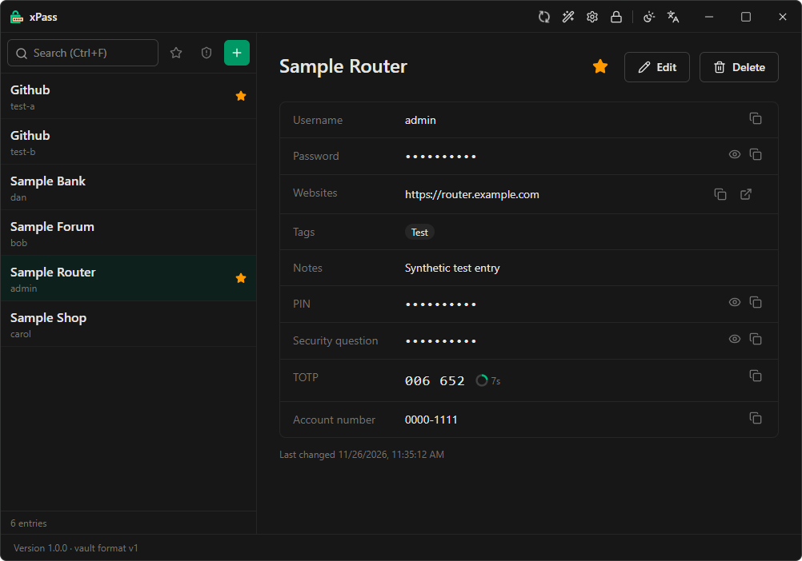

# xPass

[](https://github.com/bs135/xpass/actions/workflows/ci.yml?query=branch%3Amain)
[](https://github.com/bs135/xpass/releases/latest)
[](LICENSE)

Zero-knowledge personal password manager for Windows, built with Tauri (Rust + React).

> Status: **1.0 — first stable release.** The vault format is frozen ([docs/FORMAT.md](docs/FORMAT.md)), versions
> follow Semantic Versioning, and only the latest release is supported ([SECURITY.md](SECURITY.md)). xPass has not
> had an independent security review; it rests on its own tests, fuzzing and the self-review in
> [docs/THREAT_MODEL.md](docs/THREAT_MODEL.md). See [docs/PLAN.md](docs/PLAN.md).



<p align="center">
  
</p>

## Features (1.0)

- **Encrypted local vault** — one file, `%APPDATA%\com.bs135.xpass\vault.xpv`, with the last 10 versions kept in
  `backups\`.
- **Windows Hello unlock** — face, fingerprint or PIN instead of typing the master password; the password stays
  available and is needed to turn Hello on.
- **Master password + Emergency Kit** — a printable recovery key, confirmed at setup, unlocks the vault if the
  password is forgotten.
- **Entries** — title, username, password, websites, tags, notes, favorites, custom fields (add, rename,
  reorder, mark as secret); search and keyboard shortcuts.
- **One-time passwords (TOTP)** — an entry shows the current code of its TOTP secret with a countdown and copies
  it; add one by pasting the `otpauth://` link or the key a site shows when you turn on two-factor
  authentication. Imported TOTP secrets (Bitwarden, KeePassXC) work as they are. See
  [One-time passwords](docs/USER_GUIDE.md#one-time-passwords).
- **Password health** — the shield button in the entry list shows entries with a weak password or one used in
  several entries.
- **Password history** — the last 20 passwords of each entry, newest first, with reveal, copy and **Use this
  password**; labels show which ones came from a sync conflict, a restore or an import.
- **Import / export** — import CSV files from Bitwarden, Chrome / Edge, KeePassXC or any password manager, with a
  preview and duplicate detection; export to an encrypted KeePass (KDBX 4) file or a plaintext CSV. See
  [Import and export](docs/USER_GUIDE.md#7-import-and-export).
- **Secure copy** — copied secrets are excluded from clipboard history (`Win+V`) and cloud clipboard and are cleared
  after a timeout (default 20 s) unless you copied something else meanwhile.
- **Password generator** — random characters or EFF passphrases, with an entropy estimate.
- **Auto-lock** — on Windows lock, when the screen turns off or the PC sleeps, after inactivity on the PC (default
  5 min, can be off), optionally when minimized; closing the window keeps xPass running in the tray. See
  [Locking](docs/USER_GUIDE.md#3-locking).
- **Security settings** — change the master password, create a new Emergency Kit, rotate the vault key.
- **GitHub sync** — one vault on several PCs through a file in your private GitHub repository. Offline-first: every
  change is saved locally first and synced when GitHub is reachable; concurrent edits merge per entry, and the older
  password of an entry edited on two PCs is kept in its history. See [Sync with GitHub](docs/USER_GUIDE.md#6-sync-with-github).
- **Restore a previous version** — put the entries back as they were in one of the last 10 local versions; with
  sync on, the restore reaches your other PCs too.
- **Signed in-app update** — Settings → About finds a newer release, shows its notes and installs it after you
  confirm; xPass checks the update's signature first. Optional check at startup (off by default) only shows a
  badge; nothing is downloaded without a click. See [Updates](docs/USER_GUIDE.md#8-updates).
- **Remove old versions from GitHub** — after rotating the vault key, replace the sync branch with a single commit,
  so the old encrypted copies are no longer in its history. See [Remove old versions](docs/USER_GUIDE.md#remove-old-versions).
- English and Vietnamese UI, light/dark theme, self-drawn title bar that follows the theme.

## Security model (summary)

- A random **VaultKey** encrypts the vault (XChaCha20-Poly1305). It is stored only wrapped by key-encryption keys:
  - master password → **Argon2id** (128 MiB, t=3, p=4);
  - recovery key (256 bits) → HKDF;
  - Windows Hello (optional) → HKDF of a signature made by a key in the PC's TPM, which needs Hello consent.
- The whole file header is authenticated: any modified byte is detected and reported, never silently accepted.
- Wrong passwords are throttled: no delay for the first two attempts, then 1, 2, 4 … 30 s.
- All crypto and file handling is in Rust (`crates/xpass-core`). The WebView never holds the VaultKey. It receives a
  password or secret custom field only when you reveal it, a TOTP code (not its secret) while the entry is open, and
  generated passwords. Titles, usernames, websites, tags, **notes** and non-secret custom fields are shown when an
  entry is open, so keep secrets out of notes.
- Strict Content Security Policy (no remote content, no `eval`, no network; inline styles are allowed), minimal Tauri
  capabilities, no file-system or shell plugins.
- Secrets in memory are zeroized when the vault locks or the app exits, and the vault key sits in a memory page
  kept out of the pagefile (best effort; see the threat model in [docs/THREAT_MODEL.md](docs/THREAT_MODEL.md)).
- Dependencies are checked in CI (`cargo deny`, `npm audit`); the vault file, recovery key and TOTP parsers are fuzzed
  every week.
- Windows Error Reporting is told to leave xPass out (no report and no dump through WER, no heap in a report). Other
  ways to dump a process (a debugger, an administrator's dump policy) are not covered.
- Updates and installers are signed (update key, self-signed Authenticode certificate); each release has checksums,
  SBOMs and build provenance attestations. See [Check the download](docs/USER_GUIDE.md#check-the-download).
- **GitHub sync** uploads only the encrypted vault file. The token is kept in Windows Credential Manager and used
  only by the Rust side for requests to `api.github.com`; the WebView has no network access at all.
- **Import and export** run in Rust: files are picked in the native Windows dialog, read, parsed and written in
  Rust, and the WebView only gets a preview without passwords or notes (import) or the file name (export). Every
  export asks for the master password or Windows Hello first. A plaintext CSV export is as sensitive as the vault
  itself: see [Import and export](docs/USER_GUIDE.md#7-import-and-export).
- No telemetry. xPass connects only to GitHub: `api.github.com` for sync and the release page for updates. See
  [Privacy and network](docs/USER_GUIDE.md#11-privacy-and-network).
- **Not protected against:** malware running as your Windows user, or a stolen backup file plus a weak master
  password. Older backups keep opening with the credentials that were valid when they were written. Full list of
  what is and is not covered: [docs/THREAT_MODEL.md](docs/THREAT_MODEL.md).

## Install

Windows 11 (x64); Windows 10 22H2 works but is best effort, since Microsoft no longer ships security updates for it.
Download `xpass_<version>_windows_x64-setup.exe` from [Releases](https://github.com/bs135/xpass/releases), check
it (SHA-256, Authenticode thumbprint `4D3E068AED69DE2C88578FC2CA46439E78E73D7D`, build provenance), and expect a
SmartScreen warning: the certificate is self-signed. Details: [user guide, Install](docs/USER_GUIDE.md#1-install). Later versions
install from Settings → About.

## User guide

[docs/USER_GUIDE.md](docs/USER_GUIDE.md): first start, locking, entries, TOTP, password health,
**[backups and recovery](docs/USER_GUIDE.md#5-backups-and-recovery)** (forgotten password, lost Emergency Kit, lost PC, Windows
Hello reset, restoring a version, your own backups), sync with GitHub, import and export, updates, uninstall, where
files are kept, and privacy.

## Development

Requirements: Windows 10/11, Node.js 24+, Rust stable (MSVC), Visual Studio Build Tools (Desktop C++), WebView2.

```bash
npm install
npm run tauri dev
```

Use a throwaway vault while developing (debug builds only):

```powershell
$env:XPASS_DATA_DIR = "$env:TEMP\xpass-dev"; $env:XPASS_IDLE_SECS = "30"; npm run tauri dev
```

Checks (same as CI):

```bash
npm run lint && npm test && npm run build
cargo fmt --all --check
cargo clippy --workspace --all-targets -- -D warnings
cargo test --workspace
```

Dependency audit (CI job `audit`, also every Monday): Rust advisories, licences and sources with
[cargo-deny](https://github.com/EmbarkStudios/cargo-deny) (rules in `deny.toml`: permissive licences only, every
ignored advisory has a reason), and npm advisories at level high or above:

```bash
cargo install --locked cargo-deny   # once
cargo deny --workspace check
npm audit --audit-level=high
```

Fuzzing (every Sunday and on demand, not part of the PR checks): `crates/xpass-core/fuzz` has `cargo-fuzz` targets for the vault file parser
(`parse`), Hello unlock and sibling open (`unlock_hello`), recovery-key input (`recovery_decode`) and TOTP secrets
(`otp_parse`). Every CI run
replays the checked-in seeds and regressions on stable (`cargo test`). The **Fuzz** workflow runs each target for
15 minutes every Sunday, keeping its corpus between runs in the Actions cache (a crash makes the run red and uploads
the input); longer runs: Actions → Fuzz → Run workflow, or nightly locally:

```bash
rustup toolchain install nightly --profile minimal
cargo install --locked cargo-fuzz
cd crates/xpass-core
cargo +nightly fuzz run parse fuzz/corpus/parse fuzz/seeds/parse fuzz/regressions/parse -- -max_total_time=600
```

On Windows the AddressSanitizer runtime comes with Visual Studio: put the folder holding
`clang_rt.asan_dynamic-x86_64.dll` (`VC\Tools\MSVC\<version>\bin\Hostx64\x64`) on `PATH` first, otherwise the
target exits with `STATUS_DLL_NOT_FOUND`. A crash input lands in `fuzz/artifacts/<target>/`; after the fix, copy
it to `fuzz/regressions/<target>/` so the
replay test keeps it covered. Seeds are regenerated with
`cargo run -p xpass-core --example fuzz_seeds --features fuzzing`.

Release build: `npm run tauri build` (NSIS and MSI installers in `target/release/bundle/`).

### Releasing

The version is bumped in the release PR (`npm run release:prepare`, see [PLAN.md §7](docs/PLAN.md#7-workflow));
merging it into `main` runs the **Release** workflow, which tags, builds and publishes.

Update signing (v0.7): the in-app updater only installs files signed with the project's update key. The key pair
belongs to the repository owner and never enters the repository:

- Private key and its password: GitHub environment **`release`** (Settings → Environments) as
  `TAURI_SIGNING_PRIVATE_KEY` and `TAURI_SIGNING_PRIVATE_KEY_PASSWORD`, plus an offline backup kept by the owner.
  Only the release build job uses that environment; pull requests never see it.
- Public key: `plugins.updater.pubkey` in `src-tauri/tauri.conf.json` (base64 of the minisign `.pub` file).

`src-tauri/tauri.release.conf.json` turns on `createUpdaterArtifacts` and Authenticode signing for the release
build only, so local builds and the manual workflow run need no key.

Code signing (v0.7): a self-signed certificate (`CN=bs135 (xPass code signing)`, RSA 3072, code signing only, valid
until 2031-11-25), also owned by the repository owner. The PFX and its password are the `release` environment secrets
`WINDOWS_CERTIFICATE` (base64) and `WINDOWS_CERTIFICATE_PASSWORD`; the public certificate is
`docs/codesign/xpass-codesign.cer` and its thumbprint is `bundle.windows.certificateThumbprint` in
`tauri.release.conf.json`. The release job imports the PFX into the runner's certificate store only for the build,
tauri signs (with a timestamp) before computing the updater signatures, and `scripts/verify-authenticode.ps1` checks
every installer and the exe files inside the NSIS one. The release is created as a draft and published only after
these checks and the updater check pass; if a check fails, fix the cause and re-run the failed jobs. A release gets a `.sig` per installer and `latest.json` (the manifest the
app reads); the `verify-updater` job then checks them against the committed public key with
`scripts/verify-updater-artifacts.sh`. To sign a local build with the real key, set the two variables in your own
shell (never in a file in the repository) and run
`npm run tauri build -- --config src-tauri/tauri.release.conf.json`.

If the private key is ever lost or leaked, the public key in the app cannot be changed by an update signed with
another key: publish a release with a new key pair and tell users to install it by hand once.

Layout:

```text
crates/xpass-core/   vault format, crypto, model, merge (no UI / OS code)
crates/xpass-interop/ CSV import / export and KDBX export (no UI / OS code)
src-tauri/           Tauri app: commands and Windows integration
src/                 React + TypeScript frontend
```

## Documentation

- [docs/IDEA.md](docs/IDEA.md) — concept review and design decisions
- [docs/PLAN.md](docs/PLAN.md) — implementation plan and milestones
- [docs/USER_GUIDE.md](docs/USER_GUIDE.md) — installing, using, backing up and recovering the vault
- [docs/THREAT_MODEL.md](docs/THREAT_MODEL.md) — assets, attackers, accepted limits and the security self-review
- [docs/FORMAT.md](docs/FORMAT.md) — vault file format v1, payload schema 1 and the sync contract (frozen for 1.0)
- [SECURITY.md](SECURITY.md) — supported versions and how to report a vulnerability
- [docs/plan-v0.1.0.md](docs/plan-v0.1.0.md) — v0.1 tasks and manual test checklist
- [docs/plan-v0.2.0.md](docs/plan-v0.2.0.md) — v0.2 tasks (custom title bar) and manual test checklist
- [docs/plan-v0.3.0.md](docs/plan-v0.3.0.md) — v0.3 tasks (Windows Hello unlock) and manual test checklist
- [docs/plan-v0.4.0.md](docs/plan-v0.4.0.md) — v0.4 tasks (GitHub sync, restore) and the two-device test checklist
- [docs/plan-v0.5.0.md](docs/plan-v0.5.0.md) — v0.5 tasks (import / export, password history) and test checklist
- [docs/plan-v0.6.0.md](docs/plan-v0.6.0.md) — v0.6 tasks (hardening, update check, release process) and test checklist
- [docs/plan-v0.7.0.md](docs/plan-v0.7.0.md) — v0.7 tasks (signed updates, code signing, crash dumps, history rewrite, SBOM) and test checklist
- [docs/plan-v0.8.0.md](docs/plan-v0.8.0.md) — v0.8 tasks (TOTP, custom fields, password health, format spec) and test checklist
- [docs/plan-v1.0.0.md](docs/plan-v1.0.0.md) — 1.0 decisions (scope, versioning, support, after 1.0)
- [docs/spikes/](docs/spikes) — feasibility spikes (Windows Hello, vault format, GitHub sync)
- [CHANGELOG.md](CHANGELOG.md)

## License

[MIT](LICENSE). The passphrase generator uses the [EFF large wordlist](https://www.eff.org/dice) (CC BY 3.0 US).
KDBX export uses the [`keepass`](https://crates.io/crates/keepass) crate (MIT).
