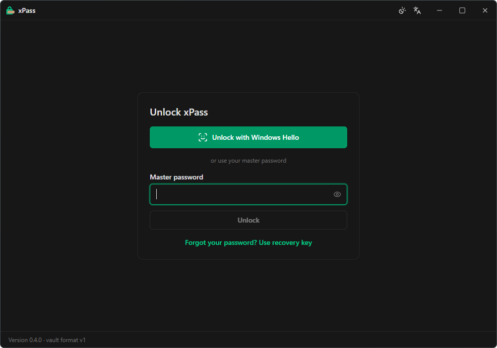

# xPass

Zero-knowledge personal password manager for Windows, built with Tauri (Rust + React).

> Status: **v0.5 — import / export and password history**. Hardening towards 1.0 (v0.6) is next. See
> [docs/PLAN.md](docs/PLAN.md).


<p align="center">
  
</p>

## Features (v0.5)

- **Encrypted local vault** — one file, `%APPDATA%\com.bs135.xpass\vault.xpv`, with the last 10 versions kept in
  `backups\`.
- **Windows Hello unlock** — face, fingerprint or PIN instead of typing the master password; the password stays
  available and is needed to turn Hello on.
- **Master password + Emergency Kit** — a printable recovery key, confirmed at setup, unlocks the vault if the
  password is forgotten.
- **Entries** — title, username, password, websites, tags, notes, favorites; search and keyboard shortcuts.
  Custom fields (for example a TOTP secret from an import) are shown read-only.
- **Password history** — the last 20 passwords of each entry, newest first, with reveal, copy and **Use this
  password**; labels show which ones came from a sync conflict, a restore or an import.
- **Import / export** — import CSV files from Bitwarden, Chrome / Edge, KeePassXC or any password manager, with a
  preview and duplicate detection; export to an encrypted KeePass (KDBX 4) file or a plaintext CSV. See
  [Import and export](#import-and-export).
- **Secure copy** — copied secrets are excluded from clipboard history (`Win+V`) and cloud clipboard and are cleared
  after a timeout (default 20 s) unless you copied something else meanwhile.
- **Password generator** — random characters or EFF passphrases, with an entropy estimate.
- **Auto-lock** — on Windows lock, when the screen turns off or the PC sleeps, after inactivity (default 5 min),
  optionally when minimized; tray icon with Open / Lock / Quit.
- **Security settings** — change the master password, create a new Emergency Kit, rotate the vault key.
- **GitHub sync** — one vault on several PCs through a file in your private GitHub repository. Offline-first: every
  change is saved locally first and synced when GitHub is reachable; concurrent edits merge per entry, and the older
  version of an entry edited on two PCs is kept in its history. See [Sync with GitHub](#sync-with-github).
- **Restore a previous version** — put the entries back as they were in one of the last 10 local versions; with
  sync on, the restore reaches your other PCs too.
- English and Vietnamese UI, light/dark theme, self-drawn title bar that follows the theme.

## Security model (summary)

- A random **VaultKey** encrypts the vault (XChaCha20-Poly1305). It is stored only wrapped by key-encryption keys:
  - master password → **Argon2id** (128 MiB, t=3, p=4);
  - recovery key (256 bits) → HKDF;
  - Windows Hello (optional) → HKDF of a signature made by a key in the PC's TPM, which needs Hello consent.
- The whole file header is authenticated: any modified byte is detected and reported, never silently accepted.
- Wrong passwords are throttled (1, 2, 4 … 30 s).
- All crypto and file handling is in Rust (`crates/xpass-core`). The WebView never holds the VaultKey and receives a
  password only when you reveal it or open the edit form.
- Strict Content Security Policy (no remote content, no `eval`), minimal Tauri capabilities, no file-system or shell
  plugins.
- Secrets in memory are zeroized when the vault locks or the app exits (best effort; see the threat model in
  [docs/THREAT_MODEL.md](docs/THREAT_MODEL.md)).
- **GitHub sync** uploads only the encrypted vault file. The token is kept in Windows Credential Manager and used
  only by the Rust side for requests to `api.github.com`; the WebView has no network access at all.
- **Import and export** run in Rust: files are picked in the native Windows dialog, read, parsed and written in
  Rust, and the WebView only gets a preview without passwords or notes (import) or the file name (export). Every
  export asks for the master password or Windows Hello first. A plaintext CSV export is as sensitive as the vault
  itself: see [Import and export](#import-and-export).
- **Not protected against:** malware running as your Windows user, or a stolen backup file plus a weak master
  password. Older backups keep opening with the credentials that were valid when they were written. Full list of
  what is and is not covered: [docs/THREAT_MODEL.md](docs/THREAT_MODEL.md).

## Sync with GitHub

xPass can keep one vault in sync across your Windows PCs through a single file in a **private** GitHub repository.
There is no xPass server: each PC talks to GitHub directly with a token that can reach only that repository.

### 1. Create a repository and a token

1. Create a **private** repository on GitHub for the vault (an empty one is fine).
2. Open GitHub → Settings → Developer settings → Personal access tokens → **Fine-grained tokens** → Generate new
   token.
3. Repository access: **Only select repositories**, and pick the vault repository.
4. Permissions: **Contents: Read and write** (Metadata: Read-only is added automatically). Nothing else.
5. Choose an expiration date and generate the token. Copy it straight into xPass; you do not need to keep it
   anywhere else.

### 2. Set up the first PC

Settings → **Sync**: enter the repository (`owner/name` or its URL), optionally a branch (default: the repository's
default branch) and the path (default `xpass/vault.xpv`), paste the token and choose **Test connection**. Save is
enabled after a passing test; a public repository needs an explicit confirmation. The first sync creates the file.

### 3. Add another PC

Install xPass and choose **Use my vault from GitHub** on the first screen: the same repository, branch and path, a
token (the same one or a new one), then your master password. The vault is downloaded and opened; your existing
Emergency Kit keeps working, and you can turn Windows Hello on for this PC.

### How it behaves

- Changes are saved on the PC first and synced 10 s after the last edit, every 5 min while unlocked, when you unlock,
  and when the vault locks or the app quits (8 s at most). **Sync now** is in the header, in Settings and in the
  tray menu. Without a connection everything keeps working; changes are synced later.
- Edits of different entries on different PCs are merged. If the same entry was edited on two PCs, the newer edit
  wins and the other one is kept in the entry's history.
- A new master password set on one PC reaches the others with the next sync (they show a notice once).
  Windows Hello is set up per PC and keeps working.
- **Rotating the vault key** with sync on needs a connection: the new file reaches GitHub first. The other PCs then
  ask for the master password once and keep their unsynced changes.
- The header icon shows the state. Problems that need you have a banner with the fix: an expired token (enter a new
  one in Settings → Sync), a vault key changed on another PC (enter the master password), or a different vault at
  the configured path (use another path, or replace this PC's vault with the one on GitHub; the current file is
  kept as a backup).

### What is stored where

| Where | What |
|---|---|
| GitHub repository | The encrypted vault file only. Each sync that changes something is one commit with the message `xpass: update vault`. |
| Windows Credential Manager | The token (`xpass/github-token`). It is never shown again, written to a file or logged. |
| `%APPDATA%\com.bs135.xpass\settings.json` | Repository, branch and path (no token). |
| `%APPDATA%\com.bs135.xpass\sync-state.json` | The last synced file versions (SHA) and the last sync time. |

Anyone who can read the repository can see **when** you synced (commit times), the **size** of the vault file and
its history, but not your entries: the file is encrypted with your vault key. Old versions stay in the git history,
so a leaked old file can be attacked with the master password that was valid then; use a strong master password
and keep the repository private.

### Turn sync off or remove the token

Settings → Sync → **Turn off sync** deletes the token from Credential Manager and the sync settings; the vault on
this PC stays. Also revoke the token on GitHub (Settings → Developer settings → Personal access tokens) when you
no longer need it. To replace an expired token, choose **Change** → **Replace token**.

## Import and export

Both are in Settings → **Import & export**.

### Import a CSV file

1. Export your passwords as CSV from the old password manager:
   - **Bitwarden**: Tools → Export vault → File format **.csv** (not the encrypted or JSON formats).
   - **Chrome / Edge**: Settings → Passwords (Password Manager) → Export passwords.
   - **KeePassXC**: Database → Export → CSV file.
   - **Other managers**: any CSV export with a header row.
2. In xPass choose **Choose CSV file…**. The format is detected from the header row and can be changed; for other
   CSV files, pick which column holds the title, username, password, website, notes, tags and favorite, and what
   happens to the other columns (leave out, add to notes, or keep as custom fields).
3. Check the preview. Rows already in the vault (same site, username and password) are skipped. Rows with the same
   site and username but another password are *possible duplicates*: skip them (default), import them as new
   entries, or update the existing entries (the old password stays in their history). Untick rows you do not want.
4. **Import**. The whole import is one change: with sync on it reaches your other PCs at once, and Settings →
   Restore a previous version undoes it.
5. **Delete the source CSV** on the result screen. The file is not encrypted.

What is imported: title, username, password, websites (all of them), notes, tags (Bitwarden folders, KeePassXC
groups), favorites, Bitwarden custom fields, TOTP secrets (as a secret custom field named `TOTP`; xPass does not
show TOTP codes yet), Bitwarden secure notes, and the creation date from KeePassXC. Not imported: Bitwarden cards and
identities (counted as left out), attachments, passkeys, and encrypted or JSON exports. Files must be UTF-8 (with or
without BOM), comma, semicolon or tab separated, at most 10 MB and 10 000 rows.

### Export

- **KeePass (KDBX)**: an encrypted KDBX 4 file (ChaCha20, Argon2id 64 MiB) protected by a new *export password*.
  KeePassXC and KeePass 2 open it. Entries go into one group `xPass`; extra websites are stored as `KP2A_URL_1`, …
  (KeePassXC shows them), favorites as the tag `favorite`, secret custom fields as protected fields, and password
  history as entry history.
- **CSV**: a **plaintext** file, readable by anyone who gets it. Do not open it in Excel or another spreadsheet app
  (they can change values), do not save it in a folder that syncs to the cloud, and delete it (and empty the Recycle
  Bin) when done. Its columns are `title, username, password, urls, notes, tags, favorite, created, updated,
  fields`; xPass imports it back with the **xPass** format.

Every export asks for the master password (or Windows Hello) and then where to save the file. Deleted entries are
not exported, and neither is password history in the CSV.

## Install

Download one installer from [Releases](https://github.com/bs135/xpass/releases):

- `xpass_<version>_windows_x64-setup.exe` (NSIS, recommended): installs for your Windows user only, without an
  administrator prompt, into `%LOCALAPPDATA%\xpass`. The first install asks for English or Vietnamese; later
  installs and updates reuse that choice.
- `xpass_<version>_windows_x64.msi`: for managed installs (Intune, Group Policy).

The WebView2 runtime is downloaded by the installer if Windows does not have it yet (it ships with Windows 11).
Installing a newer version over an older one keeps your vault and settings.

### Check the download

Builds are **not code-signed** yet. Each release (from v0.6.0) also has `SHA256SUMS.txt`; compare the installer's
hash with the line for its file name before running it:

```powershell
(Get-FileHash .\xpass_0.6.0_windows_x64-setup.exe -Algorithm SHA256).Hash.ToLower()
```

### Windows SmartScreen

Because the installer is not signed, SmartScreen may show "Windows protected your PC" on the first run. It means
Windows does not know the publisher yet, not that the file is harmful. After checking the hash, choose
**More info** → **Run anyway**. Download xPass only from the Releases page above.

### Uninstall

Settings → Apps → Installed apps → xPass → Uninstall. By default your data is **not** removed: the vault, its
backups and settings stay in `%APPDATA%\com.bs135.xpass`, and the GitHub token stays in Windows Credential Manager
(`xpass/github-token`) unless you turn sync off before uninstalling.

The uninstaller also offers a checkbox to delete the application data. Ticking it **deletes the vault and all local
backups** in `%APPDATA%\com.bs135.xpass`; only do that if the vault is synced to GitHub or you no longer need it.

## Development

Requirements: Windows 10/11, Node.js 24+, Rust stable (MSVC), Visual Studio Build Tools (Desktop C++), WebView2.

```bash
npm install
npm run tauri dev
```

Use a throwaway vault while developing (debug builds only):

```powershell
$env:XPASS_DATA_DIR = "$env:TEMP\xpass-dev"; $env:XPASS_IDLE_SECS = "30"; npm run tauri dev
```

Checks (same as CI):

```bash
npm run lint && npm test && npm run build
cargo fmt --all --check
cargo clippy --workspace --all-targets -- -D warnings
cargo test --workspace
```

Dependency audit (CI job `audit`, also every Monday): Rust advisories, licences and sources with
[cargo-deny](https://github.com/EmbarkStudios/cargo-deny) (rules in `deny.toml`: permissive licences only, every
ignored advisory has a reason), and npm advisories at level high or above:

```bash
cargo install --locked cargo-deny   # once
cargo deny --workspace check
npm audit --audit-level=high
```

Fuzzing (on demand, not part of CI): `crates/xpass-core/fuzz` has `cargo-fuzz` targets for the vault file parser
(`parse`), Hello unlock and sibling open (`unlock_hello`) and recovery-key input (`recovery_decode`). Every CI run
replays the checked-in seeds and regressions on stable (`cargo test`); longer runs use the **Fuzz** workflow
(Actions → Fuzz → Run workflow) or nightly locally:

```bash
rustup toolchain install nightly --profile minimal
cargo install --locked cargo-fuzz
cd crates/xpass-core
cargo +nightly fuzz run parse fuzz/corpus/parse fuzz/seeds/parse fuzz/regressions/parse -- -max_total_time=600
```

On Windows the AddressSanitizer runtime comes with Visual Studio: put the folder holding
`clang_rt.asan_dynamic-x86_64.dll` (`VC\Tools\MSVC\<version>\bin\Hostx64\x64`) on `PATH` first, otherwise the
target exits with `STATUS_DLL_NOT_FOUND`. A crash input lands in `fuzz/artifacts/<target>/`; after the fix, copy
it to `fuzz/regressions/<target>/` so the
replay test keeps it covered. Seeds are regenerated with
`cargo run -p xpass-core --example fuzz_seeds --features fuzzing`.

Release build: `npm run tauri build` (NSIS and MSI installers in `target/release/bundle/`).

Layout:

```text
crates/xpass-core/   vault format, crypto, model, merge (no UI / OS code)
crates/xpass-interop/ CSV import / export and KDBX export (no UI / OS code)
src-tauri/           Tauri app: commands and Windows integration
src/                 React + TypeScript frontend
```

## Documentation

- [docs/IDEA.md](docs/IDEA.md) — concept review and design decisions
- [docs/PLAN.md](docs/PLAN.md) — implementation plan and milestones
- [docs/THREAT_MODEL.md](docs/THREAT_MODEL.md) — assets, attackers, accepted limits and the security self-review
- [docs/plan-v0.1.0.md](docs/plan-v0.1.0.md) — v0.1 tasks and manual test checklist
- [docs/plan-v0.2.0.md](docs/plan-v0.2.0.md) — v0.2 tasks (custom title bar) and manual test checklist
- [docs/plan-v0.3.0.md](docs/plan-v0.3.0.md) — v0.3 tasks (Windows Hello unlock) and manual test checklist
- [docs/plan-v0.4.0.md](docs/plan-v0.4.0.md) — v0.4 tasks (GitHub sync, restore) and the two-device test checklist
- [docs/plan-v0.5.0.md](docs/plan-v0.5.0.md) — v0.5 tasks (import / export, password history) and test checklist
- [docs/plan-v0.6.0.md](docs/plan-v0.6.0.md) — v0.6 tasks (hardening, update check, release process) and test checklist
- [docs/spikes/](docs/spikes) — feasibility spikes (Windows Hello, vault format, GitHub sync)
- [CHANGELOG.md](CHANGELOG.md)

## License

[MIT](LICENSE). The passphrase generator uses the [EFF large wordlist](https://www.eff.org/dice) (CC BY 3.0 US).
KDBX export uses the [`keepass`](https://crates.io/crates/keepass) crate (MIT).
